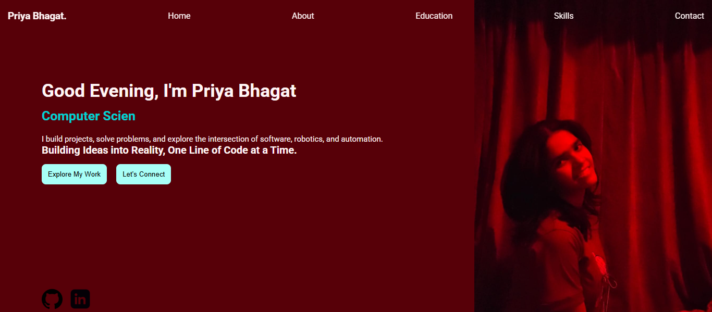
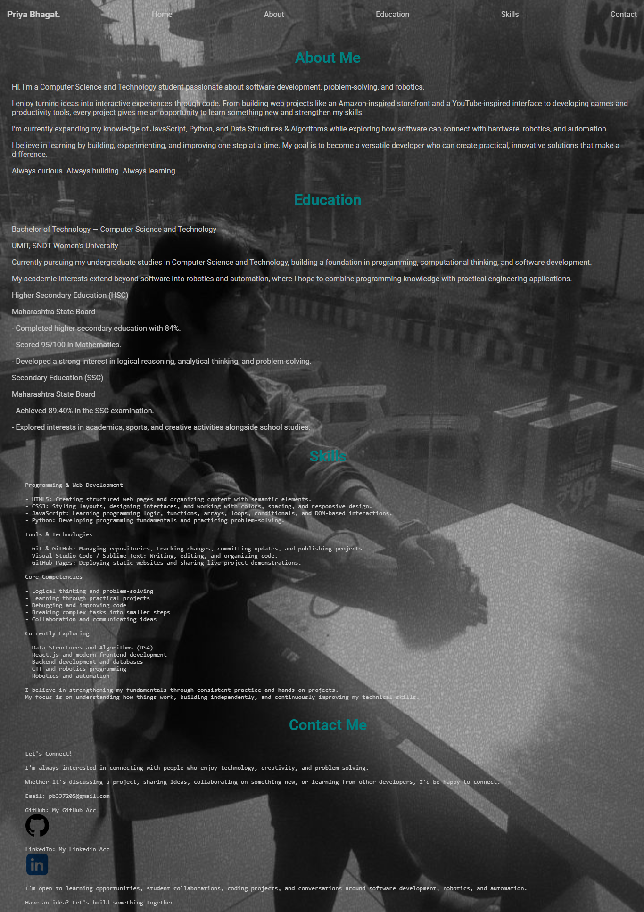
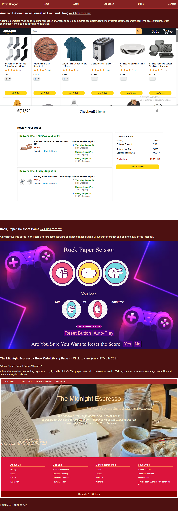

# 🌐 Personal Portfolio Website

A dynamic, professional personal portfolio website featuring real-time time-based greetings, automated role rotation, and a comprehensive showcase of web development projects and technical skills.

## 🚀 Live Demo
[👉 Explore the portfolio live!](https://priya-bhagat01.github.io/my_portfolio_website/)

## 📸 Preview
| Dynamic Main Page | About & Education | Project Showcase |
| :---: | :---: | :---: |
|  |  |  |

## 🛠️ Key Technical Features
- **Time-Aware Dynamic Greeting Engine:** JavaScript logic that automatically detects visiting hours to update headings (Good Morning, Afternoon, or Evening).
- **Animated Role Rotator:** Dynamic headline sequence cycling between "Computer Science Student", "Robotics Enthusiast", "Problem Solver" and "Aspiring Software Developer".
- **Comprehensive Multi-Section Architecture:** Clean layout structured into Home, About, Education, Skills, and Contact views.
- **Interactive Project Portfolio:** Showcases multiple full-frontend applications including an Amazon E-Commerce clone, Rock Paper Scissors game, and Book Cafe landing page.

## 🧰 Tech Stack
- **Frontend:** HTML5, CSS3, JavaScript (ES6 DOM Manipulation & Date/Time API)
- **Deployment:** GitHub Pages
- **Deployment:** GitHub Pages
